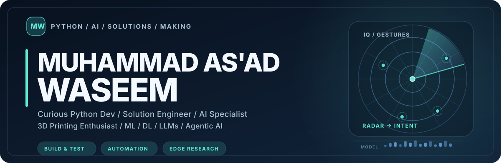
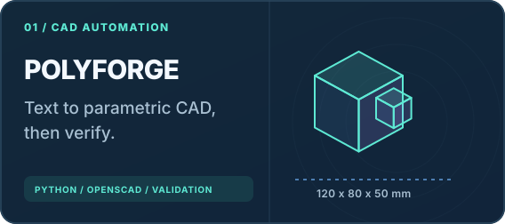
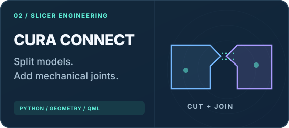
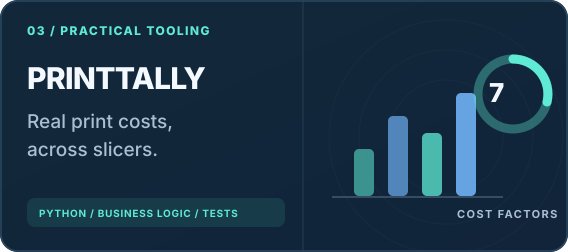
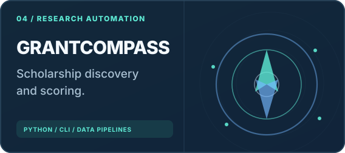
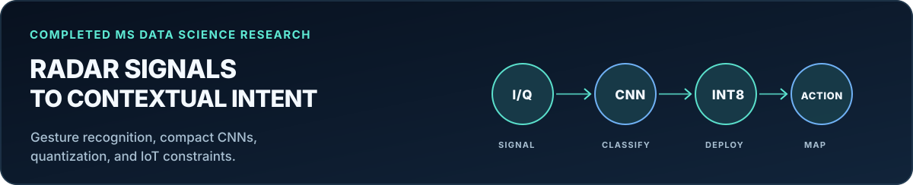

<picture>
  <source media="(prefers-color-scheme: dark)" srcset="assets/hero-dark.svg">
  <source media="(prefers-color-scheme: light)" srcset="assets/hero-light.svg">
  
</picture>

<h3>Curious Python Dev &nbsp;&middot;&nbsp; Solution Engineer &nbsp;&middot;&nbsp; AI Specialist &nbsp;&middot;&nbsp; 3D Printing Enthusiast</h3>

I work with Python, AI, and automation, and I also spend a lot of time building and experimenting with 3D printers. I like figuring out how things work, making something useful, and improving it as I go.

---

### A bit about me

I'm **Muhammad As'ad Waseem**. I'm a **curious Python dev, Solution Engineer, AI Specialist, and 3D printing enthusiast**. I spend a lot of time working with Python, trying out different ideas, and building tools that solve problems I run into. Sometimes that's an AI workflow, sometimes it's a slicer plugin, and sometimes it's something for one of my 3D printers.

I've completed my **MS in Data Science**. My thesis focused on **semantic and context-aware radar gesture recognition for TinyML and IoT devices**. I wanted to see how far I could take gesture recognition on small hardware, and how a detected gesture could mean different things depending on what someone was doing on the host device.

On the AI side, I've worked with **machine learning (ML), deep learning (DL), LLMs, and agentic AI**. I'm especially interested in connecting models with actual tools and workflows, not just getting a response from a model. [PolyForge](https://github.com/rx290/polyforge) and [GrantCompass](https://github.com/rx290/grant-compass) are two examples of that.

### Featured projects

<table>
<tr>
<td width="50%" valign="top">
<a href="https://github.com/rx290/polyforge"><picture>
  <source media="(prefers-color-scheme: dark)" srcset="assets/polyforge-dark.svg">
  <source media="(prefers-color-scheme: light)" srcset="assets/polyforge-light.svg">
  
</picture></a>

<strong><a href="https://github.com/rx290/polyforge">PolyForge</a></strong>

I wanted a way to turn descriptions and measurements into editable CAD models. This brings together Python, CAD tools, optional local AI, and checks to see if the results actually make sense.

<a href="https://github.com/rx290/polyforge">Repository and implementation</a> &nbsp; | &nbsp; <a href="https://github.com/rx290/polyforge/tree/main/tests">Tests</a>
</td>
<td width="50%" valign="top">
<a href="https://github.com/rx290/cura-connect"><picture>
  <source media="(prefers-color-scheme: dark)" srcset="assets/cura-connect-dark.svg">
  <source media="(prefers-color-scheme: light)" srcset="assets/cura-connect-light.svg">
  
</picture></a>

<strong><a href="https://github.com/rx290/cura-connect">Cura Connect</a></strong>

A Cura plugin for splitting models into printable parts and joining them back together with plugs, dowels, snaps, or dovetails. I built it around a proper geometry engine instead of just a visual trick.

<a href="https://github.com/rx290/cura-connect">Repository and implementation</a> &nbsp; | &nbsp; <a href="https://github.com/rx290/cura-connect/tree/main/tests">Tests</a>
</td>
</tr>
<tr>
<td width="50%" valign="top">
<a href="https://github.com/rx290/printtally"><picture>
  <source media="(prefers-color-scheme: dark)" srcset="assets/printtally-dark.svg">
  <source media="(prefers-color-scheme: light)" srcset="assets/printtally-light.svg">
  
</picture></a>

<strong><a href="https://github.com/rx290/printtally">PrintTally</a></strong>

I made this because pricing a 3D print is more than calculating filament cost. It also considers machine time, electricity, maintenance, labor, design work, and profit across different slicers.

<a href="https://github.com/rx290/printtally">Repository and implementation</a> &nbsp; | &nbsp; <a href="https://github.com/rx290/printtally/tree/main/tests">Tests</a>
</td>
<td width="50%" valign="top">
<a href="https://github.com/rx290/grant-compass"><picture>
  <source media="(prefers-color-scheme: dark)" srcset="assets/grant-compass-dark.svg">
  <source media="(prefers-color-scheme: light)" srcset="assets/grant-compass-light.svg">
  
</picture></a>

<strong><a href="https://github.com/rx290/grant-compass">GrantCompass</a></strong>

I wanted a better way to find funded study opportunities, compare them, and identify relevant researchers. This is a Python CLI and workflow that helps with searching, scoring, and reporting.

<a href="https://github.com/rx290/grant-compass">Repository and implementation</a> &nbsp; | &nbsp; <a href="https://github.com/rx290/grant-compass/tree/master/tests">Tests</a>
</td>
</tr>
</table>

### Research spotlight

<picture>
  <source media="(prefers-color-scheme: dark)" srcset="assets/research-dark.svg">
  <source media="(prefers-color-scheme: light)" srcset="assets/research-light.svg">
  
</picture>

For my master's thesis, I worked with **four radar gesture datasets** and trained compact CNN models at different input resolutions. I also explored **8-bit quantization** and the limits of running models on **ESP32-class microcontrollers**. The other part I found interesting was intent mapping: recognizing a gesture is one thing, but what it should do can change depending on the application you're using.

This was research and prototyping, not a commercial deployment.

### Tools and technologies

### How I work

<table>
<tr><td width="33%"><strong>01 / Figure it out</strong> Understand the problem and what I actually have to work with.</td><td width="33%"><strong>02 / Build it</strong> Get something working, then improve the parts that need work.</td><td width="33%"><strong>03 / Test it</strong> Check what works, what breaks, and where I can make it better.</td></tr>
</table>

### GitHub activity

<picture>
<source media="(prefers-color-scheme: dark)" srcset="https://github-profile-summary-cards.vercel.app/api/cards/profile-details?username=rx290&theme=github_dark">
<source media="(prefers-color-scheme: light)" srcset="https://github-profile-summary-cards.vercel.app/api/cards/profile-details?username=rx290&theme=default">

</picture>

---

<strong>Into Python, AI, or 3D printing? Feel free to explore my projects.</strong> 
<a href="https://github.com/rx290?tab=repositories">Explore my work</a> &nbsp;&middot;&nbsp; <a href="https://github.com/rx290">Connect on GitHub</a>
 I've kept my older learning projects here too. If you're new to my GitHub, the projects above are a good place to start.

